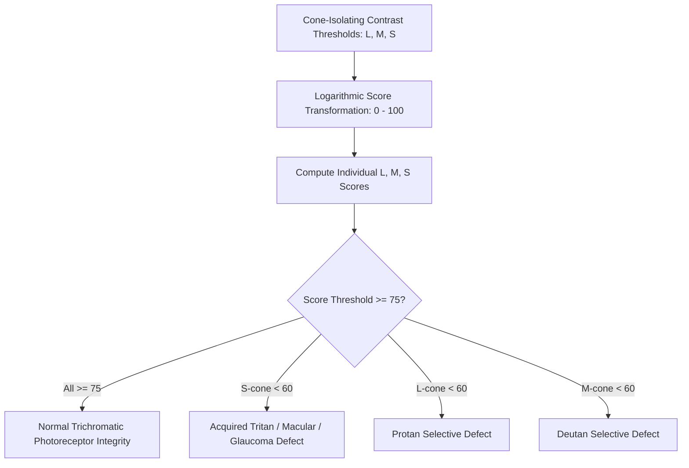

# Ocular Cone Contrast Test (CCT) Skill

[](LICENSE)
[](https://www.python.org/)
[](https://openclaw.org/)
[](https://alphapark.ai/)
[](https://modelcontextprotocol.io/)

Cone Contrast Test (CCT) and Photoreceptor Contrast Sensitivity Analyzer based on Rabin cone isolation psychophysics.



## Features
- **Zero PIP Dependencies**: Implemented strictly with Python Standard Library (`math`, `json`, `sys`, `typing`).
- **LMS Psychophysics**: Separates L, M, and S photoreceptor channels to detect subclinical maculopathies.
- **Rabin CCT Standardization**: Maps raw thresholds to calibrated 0-100 diagnostic scores.
- **Dual Architecture**: Native Python import and Model Context Protocol (MCP) JSON-RPC 2.0 stdio server.

## Quickstart
```bash
python example_usage.py
```

## License
Apache-2.0
